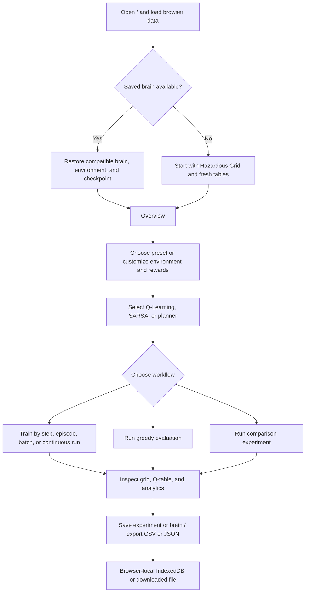
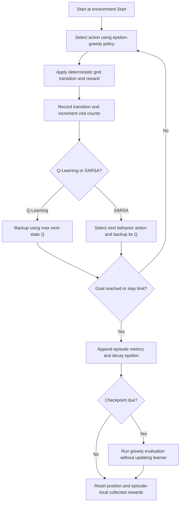
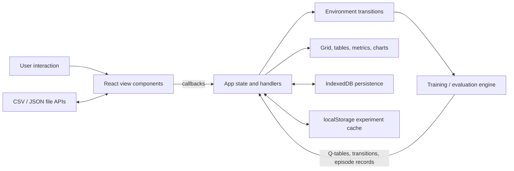
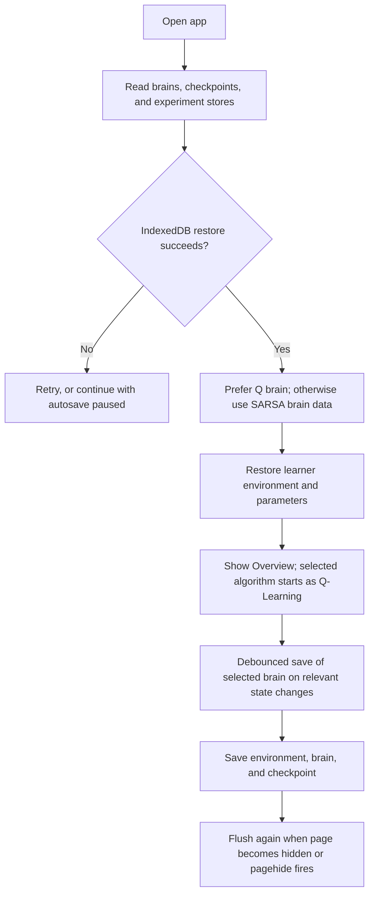
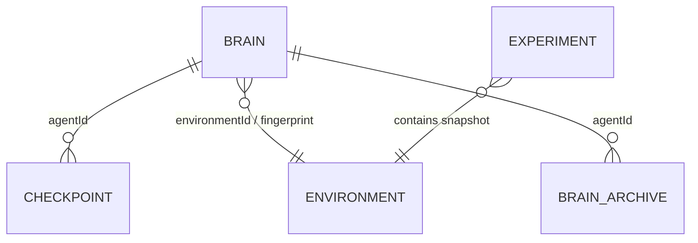

# RL Grid World Studio

**RL Grid World Studio — Autonomous Agent Intelligence Lab** is an interactive, browser-based learning environment for exploring reinforcement learning (RL) and explicit goal-directed planning. Users can edit deterministic grid worlds, train Q-Learning and SARSA agents, inspect learned state-action values, evaluate policies, and compare them with a planner that searches a known map.

The application is a static React single-page app. Simulation, analytics, persistence, and exports run in the user's browser; this repository does not include a server, remote API, hosted database, login system, or user accounts.

## Contents

1. [Project Overview](#1-project-overview)
2. [Key Features](#2-key-features)
3. [Website Pages and Navigation](#3-website-pages-and-navigation)
4. [User Journey and Workflow](#4-user-journey-and-workflow)
5. [Technology Stack](#5-technology-stack)
6. [Project Architecture](#6-project-architecture)
7. [Folder and File Structure](#7-folder-and-file-structure)
8. [Installation and Setup](#8-installation-and-setup)
9. [Environment Variables](#9-environment-variables)
10. [API Documentation](#10-api-documentation)
11. [Database and Browser Storage](#11-database-and-browser-storage)
12. [Authentication and Security](#12-authentication-and-security)
13. [UI/UX and Design System](#13-uiux-and-design-system)
14. [Error Handling and Application States](#14-error-handling-and-application-states)
15. [Deployment](#15-deployment)
16. [Testing](#16-testing)
17. [Known Limitations and Future Improvements](#17-known-limitations-and-future-improvements)
18. [Troubleshooting](#18-troubleshooting)
19. [Contributing](#19-contributing)
20. [License and Acknowledgements](#20-license-and-acknowledgements)

## 1. Project Overview

### Purpose

The studio makes tabular RL mechanics observable. An agent repeatedly moves through a grid, receives rewards, and updates its estimates of the long-term value of each action. The interface displays the grid, route, episode outcomes, and learned values so that users can connect the mathematical update rules to the agent's behavior.

It is intended for students, educators, and developers learning or demonstrating Markov decision processes, temporal-difference learning, exploration versus exploitation, reward shaping, and the difference between learning and planning.

### What makes it useful

- Compare **off-policy Q-Learning** and **on-policy SARSA** under the same environment and seeded training configuration.
- Inspect the Q-table and visit counts directly, rather than treating the agent as a black box.
- Change map topology and reward weights and immediately see how the planner's route changes.
- Keep agent brains and experiments in browser storage, or export them as files.
- Use the built-in lessons, Bellman-update calculator, guided challenge, and correctness checks to learn the concepts interactively.

In a fresh browser session, the initial environment is **Hazardous Grid**, the selected algorithm is **Q-Learning**, and the active view is Overview. Existing browser data can change the restored environment and training parameters; see [persistence behavior](#persistence-lifecycle) for the exact restore behavior.

## 2. Key Features

### Deterministic grid-world simulation

The environment engine in [`src/engine/environment.ts`](./src/engine/environment.ts) models four cardinal actions: `UP`, `RIGHT`, `DOWN`, and `LEFT`. Movement is deterministic. Walls and grid boundaries block movement and apply the obstacle penalty; hazards are traversable; reward tiles can be collected once per tile per episode; and teleporters move the agent to the next teleporter in row-major grid order when at least two exist (two portals therefore behave as a pair). Entering the goal ends the episode.

The five presets are **Simple Navigation** (5×6), **Maze Challenge** (7×7), **Hazardous Grid** (6×8), **Long-Horizon Navigation** (9×9), and **Teleporter & Reward Lab** (7×8). The Environment Studio also supports editable grids from 4×4 through 12×12.

For a transition onto a tile, the engine applies the configured reward as follows:

| Transition | Reward and effect |
|---|---|
| Valid move onto empty or Start | `stepCost`; move to the new cell. |
| Move out of bounds or into an obstacle | `obstaclePenalty`; remain at the current cell. |
| Enter a hazard | `hazardPenalty + stepCost`; move onto the hazard (not terminal). |
| Enter an uncollected bonus tile | `rewardTileValue + stepCost`; collect it once for this episode. A later re-entry gets only `stepCost`. |
| Enter the Goal | `goalReward + stepCost`; mark the episode terminal. |
| Enter a teleporter | Move to its next portal destination and receive `stepCost` for that transition. |

With the default reward settings, entering the Goal gives +99 total, a hazard gives −51, an uncollected bonus gives +14, and a blocked move gives −5. The goal reward is not also granted on subsequent steps because the episode ends immediately.

### Q-Learning and SARSA

The algorithms share the same transition and reward engine but use different temporal-difference targets:

```text
Q-Learning: Q(s,a) <- Q(s,a) + alpha * [r + gamma * max_a' Q(s',a') - Q(s,a)]
SARSA:      Q(s,a) <- Q(s,a) + alpha * [r + gamma * Q(s',a') - Q(s,a)]
```

Q-Learning backs up the best estimated next action, while SARSA backs up the next action actually selected by its epsilon-greedy behavior policy. Neither algorithm bootstraps beyond a terminal goal transition: its target is the immediate reward. Training uses epsilon-greedy selection and a seeded Mulberry32 pseudo-random number generator; greedy ties are selected uniformly at random. Exploration samples uniformly from all four actions, including moves that may hit a wall or boundary; blocked moves are represented by the environment transition and penalty rather than removed from the behavior policy.

### Goal-based planning baseline

The **Goal-Based Planner** does not train or maintain a learned Q-table. It searches the known grid using either unweighted BFS or cost-aware A*. Planner preferences include strict hazard avoidance and whether to detour for profitable bonus tiles. When strict hazard avoidance is selected, it first searches for a hazard-free route and falls back to a route that may include hazards only when no hazard-free route is found. Reward detours use a greedy profitability heuristic (bonus value versus extra step cost), not an exhaustive optimizer over every possible ordering of reward tiles. The planner is recalculated from the current environment and reward configuration and is available as a baseline in the comparison lab.

### Environment and reward design

Users can choose a preset, resize a custom grid, paint or erase cells, clear the map, or generate a randomized layout. A live reachability check reports whether the goal can be reached and shows the minimum-step distance and planner preview when available.

Four reward presets—**Balanced Navigation**, **Fastest Route**, **Safest Route**, and **Reward Collection**—are shortcuts for the reward sliders. Reward settings apply to both learning agents and the planner.

The default reward values are goal +100, step −1, obstacle/boundary −5, hazard −50, and bonus +15. The default planner uses cost-aware A*, strict hazard avoidance, and profitable-bonus detours.

### Training, evaluation, and telemetry

Training can run step-by-step, one episode at a time, or in a selected batch. The workbench exposes learning rate, discount factor, exploration start/floor/decay, episode and step limits, speed, and random seed. Evaluation uses a greedy policy with epsilon set to zero and evaluates a copy of the Q-table, leaving learned values and training statistics unchanged. Random tie-breaking among equally valued greedy actions remains seeded, so a fixed seed gives reproducible tie choices.

Recorded training data feeds the overview metrics and seven numbered analytics groups across six chart panels: raw and moving-average return, rolling success rate, episode length and its rolling average, epsilon decay, cumulative training time, and periodic greedy-evaluation reward and steps. An empirical diagnostic summarizes recent trends; it explicitly cautions that a plateau does not prove convergence.

### Comparison, experiment management, and learning aids

- Run Q-Learning and SARSA comparisons with a shared configuration, set the reward threshold, and choose one, three, or five seeded replications. The baseline protocol also reports the planner.
- Save configuration templates or completed-run summaries, duplicate/load/delete experiments, compare selected snapshots, and export episode CSV or experiment JSON.
- View ten in-app mathematical and functional checks.
- Learn through ten lessons, per-lesson questions, a live Q-Learning-versus-SARSA Bellman calculator, and a three-milestone guided challenge.
- Save, restore, reset, import, and export agent memory through IndexedDB and JSON brain bundles.

## 3. Website Pages and Navigation

### How navigation works

The site has one browser URL, `/`. The sidebar selects one of nine views using React state; these are **in-app sections, not separate URL routes**. Selecting a section does not change the address bar, and the app does not implement route-based deep links or browser-history navigation. The Vercel rewrite to `/index.html` serves the single-page app for incoming paths, but the app itself still renders the root interface.

The sidebar can be collapsed on large screens. On small screens its navigation is displayed above the content. The header shows the selected environment and provides global algorithm and execution controls. A compact status area in the sidebar reports the simulation state, selected algorithm, and episode count.

| Sidebar section | In-app key | Browser route |
|---|---|---|
| Overview | `overview` | `/` |
| Environment Studio | `environment` | `/` |
| Train Agent | `train` | `/` |
| Algorithm Comparison | `comparison` | `/` |
| Policy & Q-Table | `policy` | `/` |
| Learning Analytics | `analytics` | `/` |
| Experiments | `experiments` | `/` |
| Brain & Memory | `memory` | `/` |
| Learning Guide | `guide` | `/` |

These are all the navigation views declared in `App.tsx`. Experiments has three internal subsections, not additional routes.

### 3.1 Overview

**In-app section:** `Overview` (initial view) · **URL:** `/`

The overview combines a getting-started empty state, interactive grid preview, quick training actions, compact reward and success/step charts, and links to the larger work areas.

- If no episodes are recorded, **Start First Training** opens the training workbench and **Explore Demo Environment** loads the preconfigured demonstration.
- The preset dropdown changes the environment and resets the current training session. The **Policy Arrows**, **Q-Values**, and **Visits** buttons change the grid overlay for learned actions/values or visit counts.
- **+25 Episodes** and **+100 Episodes** run batches for the selected learning agent. **Run Instant Demo Comparison** loads the deterministic demonstration data. **Customize Grid & Rewards** opens Environment Studio.
- The compact episode-return and success/step charts use the recorded history and a 15-episode rolling window. **All 7 Charts** opens Learning Analytics.
- **Compare Agents** opens Algorithm Comparison.
- The always-visible seven-card KPI strip reports the active algorithm, episode counter/budget (or N/A for the planner), rolling average reward, rolling success rate, rolling average steps, current epsilon (or zero in evaluation/planner mode), and simulation status/mode. Before learner episodes exist, learner reward/success values display as zero; the planner cards use its current computed route. After training starts, reward/success/steps use the last rolling window (15 episodes), not the separate greedy checkpoint series.
- The live summary links to the comparison lab and reflects the selected algorithm and current recorded metrics.

The grid, history, environment, and analytics are supplied by the app's in-memory React state. No API request is made.

### 3.2 Environment Studio

**In-app section:** `Environment Studio` · **URL:** `/`

The page has a preset selector and actions above a two-column grid editor and reward/planner configuration panel.

- Choose one of the five preset cards. **Restore Preset** restores the currently selected built-in preset (or Hazardous Grid if no preset is selected).
- **Clear Grid** creates a blank custom grid with Start at the upper-left and Goal at the lower-right. **Randomize Tiles** creates a new layout with randomly placed obstacles, hazards, and rewards while keeping Start and Goal at opposite corners.
- Rows and columns accept values from 4 to 12. Resizing preserves overlapping non-start/non-goal cells and clamps the Start and Goal coordinates into the new dimensions; if clamping would overlap them, Goal is moved to the lower-right cell. Shrinking can discard tiles that fall outside the resized grid.
- Select a paint tool—Obstacle, Hazard, Bonus, Portal, Start, Goal, or Eraser—then click or drag across cells. Start and Goal cannot be overwritten by other tile types or placed on the same cell. Painting a tile with the same selected non-empty tool toggles that cell back to empty. A portal only teleports when at least two portal cells exist.
- The reachability banner reports whether a path exists and displays the minimum-step path length and current planner preview length/expected return. The minimum-step validator respects obstacles and portals, but ignores reward costs and hazard penalties. **Show Optimal Route Preview** toggles the configured planner path overlay. An unreachable goal is reported as a warning; the editor does not automatically repair the map.
- Reward presets apply one of the four predefined reward configurations. Sliders adjust goal reward, per-step cost, hazard penalty, obstacle/boundary penalty, and bonus value.
- Planner options choose cost-aware A* or unweighted BFS and toggle strict hazard avoidance and bonus detours. These settings affect the planner, not the Q-Learning or SARSA update rules.

Any environment change is passed to the app shell, which resets both learner tables, both visit tables, and the current episode/checkpoint history so the training state matches the changed map. If a trained learner is active, its brain is first archived asynchronously where possible. Changing reward settings or planner preferences does not itself reset the learned tables; reset before a new training run if a clean comparison is required.

### 3.3 Train Agent

**In-app section:** `Train Agent` · **URL:** `/`

The workbench displays a live grid, a decision/transition inspector, algorithm controls, simulation controls, and hyperparameter settings. Choose Q-Learning, SARSA, or Goal-Based Planner in the global header.

- **Training Mode** uses epsilon-greedy actions and updates the selected learner's Q-table. **Evaluation Mode** selects greedy actions with epsilon zero and leaves Q-values and episode training history unchanged. Both mode buttons reset the agent's current position and per-episode display counters, not the learned table. In evaluation mode, manually stepping the agent does not append training episodes or checkpoints.
- **Start Training** begins the timer-driven simulation; **Pause/Resume** controls it; **Stop** ends continuous execution and returns the agent to Start without clearing learned values. **Execute 1 Step** advances once, and **Run 1 Episode** completes an episode. A numeric batch field (1–1000) and **Train N Ep** run the full selected number of episodes synchronously. The app also exposes one-step and one-episode shortcuts in the global header.
- A step shows the current coordinate, action values, chosen transition, immediate reward, collision/hazard/bonus/teleporter flags, and—during learner training—the Q-value before/after update and TD target/error. The grid displays the trail and current agent position.
- Sliders configure alpha (0.01–1.00), gamma (0–0.99), epsilon start (0–1), epsilon minimum (0–0.5), epsilon decay (0.900–0.999), maximum episodes (20–1000), maximum steps per episode (15–300), and simulation speed. A seed input controls the PRNG. The default configuration is alpha 0.25, gamma 0.95, epsilon start 0.35, epsilon minimum 0.10, decay 0.995, 250 episodes, 100 steps per episode, speed 3, seed 42. **Restore Defaults** changes the hyperparameter form values; it does not clear the Q-table or episode history.
- Speed levels 1–3 animate individual steps at different intervals; level 4 advances one episode per timer tick; level 5 advances five episodes per timer tick. Batch training runs synchronously. The configured maximum episode count stops the continuous timer loop, but explicit episode batches are not clamped to the remaining budget and can run past it.
- If an epsilon-start slider change is made before any episode completes, the current epsilon is updated immediately. Later epsilon-start changes affect the hyperparameter setting but do not reset the current decayed epsilon. Other parameter changes do not clear existing experience.
- Episode completion records reward, steps, goal success, hazards, obstacle collisions, collected bonuses, epsilon, and duration. Step-at-a-time training records a greedy checkpoint at episode 1, every 15 episodes, and the configured final episode. Batch training also checkpoints the last episode of each batch; continuous speed 4 uses one-episode batches, and speed 5 uses five-episode batches.
- Reset actions in the global header request confirmation when training data exists and clear the current session's Q-tables, visits, counters, history, and checkpoints. They do not mean the same thing as **Stop**.

With the Goal-Based Planner selected, batch execution switches to evaluation visualization and displays the computed route immediately; it does not create RL episodes or learn Q-values. If no route exists, the path cannot reach the goal.

### 3.4 Algorithm Comparison

**In-app section:** `Algorithm Comparison` · **URL:** `/`

Select **Controlled RL** (Q-Learning vs. SARSA) or **Baseline Benchmark** (also displays the Goal-Based Planner), set the reward threshold, and select one, three, or five seed replications. The **Run** button trains the two RL agents with the same environment, episode budget, hyperparameters, and seed sequence. Each seed is the configured base seed plus 17 per replication. Both learners start with fresh Q-tables for each comparison; the comparison does not continue from the current interactive training tables.

Each RL seed is evaluated in five greedy trials from the same start state; the planner is evaluated as one computed route. The result table includes greedy-evaluation success/failure, reward, steps, training and evaluation hazard counts, episodes to the selected threshold, and measured training/evaluation time. The threshold episode is the first point whose up-to-10-episode rolling return reaches the threshold and whose window includes at least one goal-reaching episode. Multiple replications show the mean and population standard deviation for RL reward and success rate.

The charts overlay Q-Learning/SARSA 15-episode moving-average rewards and rolling steps; the baseline protocol adds the planner reward line and row. The trajectory selector chooses the sample greedy evaluation route for Q-Learning or SARSA, or the planner path. The current route is drawn over the grid and its coordinate sequence appears below it. Comparison work is synchronous in the browser's main thread. The trained first-seed Q-tables are copied back to the shared policy inspector; comparison curves/results remain in the comparison view and do not replace an already-populated global episode history. If global history was empty, the first-seed Q-Learning history and checkpoints seed the Overview/Analytics history.

The comparison is calculated locally when run. It does not call a benchmark service. Results are held in app state until the user saves an experiment or brain data separately.

### 3.5 Policy & Q-Table

**In-app section:** `Policy & Q-Table` · **URL:** `/`

This view inspects the Q-Learning or SARSA table (it does not offer a planner Q-table). The algorithm switcher selects the table; the grid shows a four-action Q split, greedy policy arrows, or visit heatmap. Selecting a cell in the grid or table row updates the state inspector.

The inspector shows tile type, visit count, maximum Q-value, greedy action(s), and each of the four directional Q-values. The full table lists coordinates, tile type, visits, all four Q-values, maximum value, and the best-valued action(s). **Hide Unvisited States** removes cells with no visits or nonzero values; the search field filters by coordinate text or tile type. If filtering yields no rows, **Clear filters** resets both filters.

An explainer reports traversable-state coverage and clarifies that zero values can be uninitialized, rather than a learned preference. It is normal for an untrained table to show no learned policy yet. The table includes every coordinate, including obstacle and terminal cells; the coverage percentage counts only non-obstacle cells. Selecting a table row updates the grid selection/inspector; clicking a grid cell does the same. In the reusable grid canvas, hovering a cell also reveals its tile, visit count, and four Q-values when a table is supplied.

### 3.6 Learning Analytics

**In-app section:** `Learning Analytics` · **URL:** `/`

The page visualizes recorded episodes and greedy evaluation checkpoints. Its moving-average window selector supports 5, 10, 15, 25, or 50 episodes; changing it recalculates the rolling measures. **+50 Episodes** trains the active learner; selecting the planner instead visualizes its route without generating training episodes.

Seven chart panels show:

1. Raw episode reward and moving-average reward.
2. Rolling goal success percentage.
3. Raw steps and rolling average steps.
4. Epsilon by episode.
5. Cumulative training time.
6. Greedy checkpoint evaluation return and steps.

The six chart panels carry seven numbered groups: (1–2) raw and moving-average return, (3) rolling success, (4) raw and rolling-average steps, (5) epsilon, (6) cumulative training time, and (7) greedy checkpoint reward and steps. The analytics engine computes a per-episode throughput field as well, but no current chart displays it. An empirical interpretation panel compares the average return in the first and last quarters, reports recent epsilon/hazard context, and includes a caveat that stable curves do not establish mathematical convergence. With no episode history, an empty state offers **Train 50 episodes** and **Train 150 episodes**.

### 3.7 Experiments

**In-app section:** `Experiments` · **URL:** `/` · **Subsections:** Experiment Registry & Exports, Correctness Verification Suite, Architecture & Local Setup README

**Experiment Registry & Exports**

- Enter an experiment label and select **Completed Run** or **Configuration Template Only**. Save stores the environment, selected algorithm, hyperparameters, reward and planner configuration, and (for a completed run with history) an evaluation summary and up to the final 30 episode records. A completed-run selection with no history is saved as a config-only template.
- Cards can be loaded, duplicated, exported as JSON, or deleted (demo records cannot be deleted). Loading a completed RL experiment deterministically replays its recorded episode count from its seed to reconstruct the Q-table and history; loading a template applies its setup without replaying training.
- Select at least two experiments to display a side-by-side comparison of environment, algorithm, parameters, seed, episode count, and saved evaluation metrics. **Clear Selection** removes the selection.
- **Export Results CSV** downloads the current episode history. **Export Config JSON** downloads the current setup, while a card's **JSON** action exports that saved experiment. Both exports also appear in a preview where **Copy Raw Content** and **Close** are available.
- The registry includes preconfigured demo/template examples when no saved experiment list is available. Browser persistence is local to the current browser profile.

The episode CSV header is `episode,algorithm,totalReward,steps,reachedGoal,hazardHits,obstacleHits,rewardsCollected,epsilon,durationMs`. Experiment JSON serializes the saved experiment object: id/name/timestamp/type, environment, algorithm, hyperparameters, reward/planner settings, completed-episode count, and optional evaluation summary/final history sample. The UI does not provide an experiment JSON import action; loading a registry card is the in-app restore mechanism.

**Correctness Verification Suite**

Entering the subsection runs the ten in-app checks; **Re-Run All 10 Unit Tests** runs them again. Results show each check's pass/fail, category, assertion details, and duration. Coverage includes both Bellman targets, terminal no-bootstrap behavior, epsilon-greedy selection, blocked movement, planner paths and unreachable goals, evaluation immutability, reset-state initialization, and CSV/JSON fidelity. These checks are executed by the application, not by an `npm test` command.

The individual checks are: Q-Learning maximum-next-value backup; SARSA selected-next-action backup; terminal targets do not bootstrap; empirical epsilon-greedy exploration rate and greedy choice; obstacle/boundary impassability; valid planner path; unreachable-goal handling; evaluation does not mutate table/visits; fresh Q/visit initialization after reset; and CSV/JSON export fidelity. They are synchronous functions in `runAllVerificationTests()`, not tests registered with an external test framework.

**Architecture & Local Setup README**

This third subsection is a brief static architecture/setup panel inside the product. It is separate from this repository's root README. Its displayed command examples are not authoritative for npm scripts; use [Installation and Setup](#8-installation-and-setup) and [Testing](#16-testing) here.

### 3.8 Brain & Memory

**In-app section:** `Brain & Memory` · **URL:** `/`

Choose Q-Learning, SARSA, or Goal-Based Planner to see that agent's saved status (`Fresh`, `Trained`, or `Restored` in normal app-generated saves), episode count, explored states, Q-table size (for learners), associated environment, latest checkpoint, save time, and last evaluation. The type also includes `Modified`, but the current save builder does not assign that status.

- **Save Brain** explicitly saves the selected learner's brain and training checkpoint; changes are also autosaved to IndexedDB after a short debounce and when the page becomes hidden or is unloaded. The planner stores configuration/status only, not a learned Q-table.
- **Resume Learning** returns to training and, for a learner whose configured episode budget has been reached, extends the budget by 100. It is disabled for the planner.
- **Evaluate Brain** evaluates greedily (five trials for a learned agent; one planner route), displays the outcome, and saves evaluation metadata without modifying Q-values or training history.
- **Export Brain** downloads a JSON bundle containing the brain and environment, with a matching checkpoint when available. **Import Brain** accepts JSON, checks the supported schema and environment fingerprint, then asks for confirmation before replacing the matching saved brain. Learner imports also restore their associated environment and settings.
- **Reset Brain** asks for confirmation before resetting the selected agent's in-session learned table/history or planner memory. Export a backup first if it is needed.

Brains are browser-local and do not synchronize across browsers or devices. The page warns when IndexedDB is unavailable or a saved brain belongs to a different environment.

### 3.9 Learning Guide

**In-app section:** `Learning Guide` · **URL:** `/`

The page includes a guided Hazardous Grid challenge, a ten-lesson learning path, questions, and an interactive Bellman update calculator.

- **1-Click Load Challenge Preset** selects Hazardous Grid, switches to SARSA, and opens Train Agent. **Open Comparison Lab** opens the comparison section.
- The three challenge milestones are checked from live state: Hazardous Grid selected; at least 30 episodes plus at least 80% greedy evaluation success and zero average evaluation hazards; and a completed baseline comparison.
- Select a lesson from the path or use **Prev**/**Next**. Each lesson includes an explanation, grid-world example, formula, takeaway, and multiple-choice quick check. Select an answer and **Check answer** to see feedback; only a correct answer marks the lesson complete. Completion is held in the guide view's component state and is not persisted; leaving and reopening the view or reloading resets it.
- The Bellman sandbox lets users edit current Q, reward, alpha, gamma, next-state maximum Q, and sampled-next-action Q. It calculates and displays both targets and updated values without changing the saved agent.

### Global controls

The top header's algorithm buttons switch among Q-Learning, SARSA, and the planner. When a compatible saved brain exists for the selected environment, switching can restore its configuration and history. The header also provides Start/Resume or Pause, one-step execution, one-episode execution, and a confirmed simulation reset. The desktop sidebar includes **Load Demo Benchmark** and **Reset Simulation**. The preconfigured demo banner offers **Clear Demo & Start Fresh**.

## 4. User Journey and Workflow

There is no registration, login, account setup, or logout. A new visitor lands on Overview and can either start training, customize the map, or load the demonstration.



### Typical first run

1. Open the Overview and choose **Start First Training**, or open Environment Studio to choose/edit a map.
2. Select Q-Learning or SARSA in the global header and review the training parameters.
3. Use **Execute 1 Step** to observe a single transition, **Run 1 Episode** to finish one episode, or start continuous/batch training.
4. Inspect the learned action values and visitation patterns in Policy & Q-Table. Review training and greedy evaluation trends in Learning Analytics.
5. Use Algorithm Comparison to compare both learners and optionally the planner on the current setup.
6. Save a reproducible experiment or agent brain, or export the recorded episodes/configuration for use outside the browser.

On later visits to the same browser profile, the app attempts to restore saved brain data and experiments. There is no account-level synchronization.

### What happens during one learner episode



In the episode runner, a bonus-collection set is reset for each episode, while the Q-table and visit table persist across episodes. Evaluation clones the Q-table, uses epsilon zero, and runs up to the configured per-episode step limit. The seeded evaluation trials use seeds `baseSeed + 1000 + trialIndex`; Q-value ties still use the seeded random chooser.

## 5. Technology Stack

| Area | Technology | Use in this project |
|---|---|---|
| UI | React 18 | Component rendering and local application state. |
| Language | TypeScript 5, strict mode | Domain types for environments, episodes, algorithms, brains, and experiments. |
| Build/dev server | Vite 5 with the React plugin | Local development server and static production bundle. |
| Styling | Tailwind CSS 3, PostCSS, Autoprefixer, small `src/index.css` base styles | Utility-based responsive styling, focus-visible outlines, and reduced-motion behavior. |
| Charts | Recharts 2 | Learning analytics and comparison charts. |
| Icons | Lucide React | Interface icons. |
| State management | React `useState`, `useRef`, and `useEffect` | Simulation state, timer-driven training, restoration, and debounced persistence. No external state library or context provider is used. |
| Persistence | Browser IndexedDB and a small `localStorage` experiment cache | Local brains/checkpoints/environments/experiments and compatibility fallback for experiment records. |
| Deployment config | Vercel static hosting configuration | Builds `dist` and rewrites requests to the SPA entry point. |

The RL engine and training logic are plain TypeScript modules and run in the browser's main JavaScript context. No backend framework, remote database, API client, authentication provider, or third-party service integration is configured.

## 6. Project Architecture

### Frontend and simulation layers

- [`src/main.tsx`](./src/main.tsx) creates the React root, wraps the app in `React.StrictMode` and `AppErrorBoundary`, and imports the global stylesheet.
- [`src/App.tsx`](./src/App.tsx) owns navigation, environment/algorithm settings, Q-tables, live simulation, episode history, experiment actions, browser-memory restoration, and persistence scheduling. It passes data and callbacks to view components.
- [`src/components/`](./src/components) contains page-level panels and reusable UI pieces. These render the app state and report user actions through props.
- [`src/engine/`](./src/engine) contains environment transitions, learning algorithms, training/evaluation, analytics, deterministic random generation, experiment serialization, and IndexedDB operations.
- [`src/types/rl.ts`](./src/types/rl.ts) defines the TypeScript data contracts used across the UI, engine, persistence, and tests.

### Component responsibilities

| Component | Responsibility |
|---|---|
| `GridCanvas.tsx` | Shared interactive grid: tile symbols, current agent, trail/planned path, policy-arrow/Q-split/visit overlays, cell selection, and optional click/drag painting. |
| `EnvironmentStudioView.tsx` | Preset selection, custom topology editor, reachability display, reward presets/sliders, and planner settings. |
| `AnalyticsView.tsx` | Rolling-window selection, seven numbered analytics groups, curve interpretation, and quick-training actions. |
| `ComparisonLabView.tsx` | Controlled/baseline run settings, empirical result table, reward/steps charts, and selected-agent route inspector. |
| `PolicyQTableView.tsx` | Q-Learning/SARSA table switching, interactive value map, state inspector, filters, and complete table. |
| `ExperimentsAndTestsView.tsx` | Experiment registry, compare/save/load/export actions, test-suite display, and the static in-app setup/architecture panel. |
| `BrainMemoryView.tsx` | Per-agent storage status and memory actions: save, resume, evaluate, import/export, and reset. |
| `LearningGuideView.tsx` | Live challenge milestones, ten interactive lessons, knowledge checks, and isolated Bellman sandbox. |
| `UIStates.tsx` | Shared page/section loading, empty/error/warning states, operation status, toast viewport, confirmation dialog, and render error boundary. `SectionLoader` and `InlineError` are defined but are not currently used by the app. |

### Engine responsibilities

| Module | Key behavior |
|---|---|
| `environment.ts` | Defines presets/defaults, coordinate helpers, available-action inspection, transition/reward rules, teleporter resolution, and BFS reachability validation. |
| `agents.ts` | Initializes Q-values, chooses epsilon-greedy actions, updates Q-Learning/SARSA values, and builds the planner route/policy map. |
| `training.ts` | Runs full episodes, decays epsilon, performs greedy evaluation, finds return thresholds, and orchestrates comparisons. |
| `analytics.ts` | Computes rolling reward/success/steps and cumulative time plus heuristic written diagnostics; it does not calculate statistical convergence guarantees. |
| `brainPersistence.ts` | Creates the IndexedDB stores and implements brain, environment, checkpoint, experiment, archive, and JSON brain-bundle operations. |
| `experiments.ts` | Contains preconfigured demo/template records, a localStorage fallback cache, and CSV/JSON serialization. |
| `prng.ts` | Implements the Mulberry32-based seeded random generator used by learning and evaluation. |

### Data and control flow



Q-Learning and SARSA each have separate Q-tables and visit tables in application state. Single-step training applies a transition and update to a copied table before committing it to React state; batch training runs complete episodes through `runTrainingEpisode`. Evaluation clones the Q-table and uses epsilon zero. The Goal-Based Planner calculates a path from the known environment rather than reading or updating a learned table.

### Persistence lifecycle

On startup, the app loads saved Q-Learning, SARSA, and planner records, plus matching checkpoints for any saved brain. The learner workspace selection prefers a saved Q-Learning brain, otherwise a saved SARSA brain, and restores that brain's environment and parameters; **the startup code does not change the selected algorithm from its initial Q-Learning value**. If only SARSA data exists, explicitly select SARSA in the header to attach the SARSA table/history to the active algorithm. See [known limitations](#17-known-limitations-and-future-improvements) for this restore inconsistency. Planner-only saved data is loaded into the memory view but does not restore the startup environment through this learner-workspace path.

After startup, saved IndexedDB experiments replace the fallback list when that store contains records. For the currently selected learner brain (or planner configuration), the app schedules saves after relevant state changes with a short debounce and flushes on page visibility/unload events. If IndexedDB restoration fails, choosing **Continue without restoring** leaves existing data untouched and pauses automatic saving for the session. This avoids overwriting data that could not be read.



See [Database and Browser Storage](#11-database-and-browser-storage) for store names and saved structures.

## 7. Folder and File Structure

This tree lists the application and configuration files present in the repository; generated `dist/` output and installed `node_modules/` are excluded.

```text
rl-grid-world-studio/
├── index.html
├── package.json
├── package-lock.json
├── postcss.config.js
├── tailwind.config.js
├── tsconfig.json
├── vercel.json
├── vite.config.ts
├── .gitignore
├── README.md
└── src/
    ├── App.tsx
    ├── index.css
    ├── main.tsx
    ├── components/
    │   ├── AnalyticsView.tsx
    │   ├── BrainMemoryView.tsx
    │   ├── ComparisonLabView.tsx
    │   ├── EnvironmentStudioView.tsx
    │   ├── ExperimentsAndTestsView.tsx
    │   ├── GridCanvas.tsx
    │   ├── LearningGuideView.tsx
    │   ├── PolicyQTableView.tsx
    │   └── UIStates.tsx
    ├── engine/
    │   ├── agents.ts
    │   ├── analytics.ts
    │   ├── brainPersistence.ts
    │   ├── environment.ts
    │   ├── experiments.ts
    │   ├── prng.ts
    │   └── training.ts
    ├── tests/
    │   └── rl.test.ts
    └── types/
        └── rl.ts
```

| Path | Responsibility |
|---|---|
| `index.html` | Vite HTML entry point and React mount element. |
| `package.json`, `package-lock.json` | Dependency manifest, available npm scripts, and locked dependency versions. |
| `vite.config.ts` | React plugin, production sourcemap setting, and vendor chunk configuration. |
| `tsconfig.json` | Strict, no-emit TypeScript configuration for `src`. |
| `tailwind.config.js`, `postcss.config.js` | Tailwind content scanning and PostCSS plugin setup. |
| `vercel.json` | Vite build/output settings and SPA rewrite. |
| `.gitignore` | Excludes dependencies, build output, local environment files, Vercel metadata, and logs. |
| `src/main.tsx`, `src/App.tsx`, `src/index.css` | React bootstrap/error boundary, application shell and shared state, and global styles. |
| `src/components/` | Grid renderer, nine application views, and shared loader/error/empty-state/toast/dialog UI. |
| `src/engine/environment.ts` | Presets, reward defaults, movement rules, transitions, and map reachability validation. |
| `src/engine/agents.ts` | Q-table helpers, epsilon-greedy selection, Q-Learning/SARSA backups, and BFS/A* planning. |
| `src/engine/training.ts` | Episode execution, epsilon decay, greedy evaluation, threshold detection, and multi-seed comparisons. |
| `src/engine/analytics.ts` | Rolling metrics and descriptive learning-curve diagnostics. |
| `src/engine/prng.ts` | Seeded Mulberry32 random number generator. |
| `src/engine/experiments.ts` | Demo experiment data, localStorage experiment cache, and CSV/JSON serializers. |
| `src/engine/brainPersistence.ts` | IndexedDB schema, brain/checkpoint/experiment persistence, environment fingerprints, and brain import validation. |
| `src/types/rl.ts` | Shared type definitions for the domain and saved data. |
| `src/tests/rl.test.ts` | Ten in-app verification checks invoked by the Experiments view. |

There is no `public/` assets directory or screenshot set in the repository. No server, API, or database migration folder is present.

## 8. Installation and Setup

### Prerequisites

- Node.js 18.x or 20 and later, as allowed by the locked Vite 5 dependency (`^18.0.0 || >=20.0.0`; Node 19 is not in this range).
- npm, included with Node.js.
- A modern browser with JavaScript and IndexedDB enabled for persistent memory. The app can still start without IndexedDB, but cannot persist brains there.

The project does not pin a Node/npm version in `package.json`.

### Clone and install

```bash
git clone https://github.com/sri200723/gridmind.git
cd gridmind
npm install
```

If you already have this repository checked out, run the commands from its root directory.

### Run the development server

```bash
npm run dev
```

Open the local URL printed by Vite in the terminal.

### Type-check and production build

```bash
npm run build
```

The build script runs `tsc` first and then `vite build`; generated static files are written to `dist/`.

### Preview the production build

```bash
npm run preview
```

There is no separate backend or database setup step. Persistent data is created in the browser when the app runs.

## 9. Environment Variables

No environment variables are read by the application or its Vite configuration. There are no required API keys, service URLs, or database credentials, and no `.env.example` is needed for the current implementation.

The repository's `.gitignore` excludes `.env` files, but that does not indicate that the app currently consumes them.

## 10. API Documentation

There are no application HTTP API endpoints. The frontend does not call `fetch`, a backend server, or an external service. Simulation and data processing use imported TypeScript functions in the same browser process.

The app does use browser-native APIs for local functionality:

| Browser API | Purpose |
|---|---|
| IndexedDB | Persist brains, environments, checkpoints, and experiments on the device. |
| `localStorage` | Compatibility/fallback cache for saved experiments. |
| `Blob`, object URLs, and an anchor download | Export CSV, experiment JSON, and brain JSON files. |
| File input and `File.text()` | Read a selected brain JSON file for import. |
| Clipboard API, with a textarea fallback | Copy export-preview content. |

These are browser APIs, not network endpoints.

## 11. Database and Browser Storage

The application uses **IndexedDB**, not a server-hosted or relational database. The database is named `rl-grid-world-studio-memory` and is created at version 1 by [`src/engine/brainPersistence.ts`](./src/engine/brainPersistence.ts). Schema upgrades are handled in `openDatabase()` with `onupgradeneeded`; there are no SQL migrations or server-side schema.

| Object store | Key | Stored data |
|---|---|---|
| `brains` | `agentId` | Latest brain state for Q-Learning, SARSA, or the Goal-Based Planner, including configuration and (for learners) Q-values and visit counts. |
| `environments` | `id` | Environment configuration associated with saved work. |
| `checkpoints` | `id`; non-unique `agentId` index | Training snapshots, episode history, evaluation checkpoints, Q-table, visit counts, epsilon, and seed. Startup selects a matching checkpoint no later than the brain's saved episode count. |
| `experiments` | `id` | Saved experiment configuration, evaluation summary, and any stored history sample. |
| `brainArchives` | `id`; non-unique `agentId` index | Prior brain snapshots archived when the environment changes after training. The current UI does not provide an archive browser/restore screen. |

The separate experiment cache uses localStorage key `rl_grid_world_studio_experiments_v1`. When IndexedDB has no experiment records, the app can continue to show this cache or its preconfigured demo/template experiments. Saved experiments are written to both the cache and IndexedDB.

The TypeScript shapes for environments, checkpoints, brains, and experiments are defined in [`src/types/rl.ts`](./src/types/rl.ts). These stores are local to the browser's origin and profile; clearing site data or changing browser/device can remove or make them unavailable. Brain JSON export/import is the implemented transfer mechanism.

Important fields in the saved TypeScript objects:

| Record | Key fields |
|---|---|
| `EnvironmentConfig` | `id`, `name`, dimensions, `grid` tile matrix, `startPos`, `goalPos`, and description. |
| `AgentBrainState` | `schemaVersion`, `agentId`/algorithm, environment id and fingerprint, optional Q/visit tables, hyperparameters, planner/reward settings, epsilon, completed episode count, cumulative reward, seed, last evaluation, and timestamps. |
| `BrainCheckpoint` | `id`, agent and environment fingerprint, Q/visit tables, epsilon, completed episodes, episode history, evaluation checkpoints, seed, and timestamp. |
| `SavedExperiment` | id/name/time/type, environment, algorithm, parameters, rewards/planner settings, episode count, and optional summary/history sample. |

Coordinates are `{ row, col }`; Q-values are keyed by `"row,col"` and contain one value per cardinal action. The database has no foreign-key constraints: environment references and fingerprints are application-level fields.



The diagram describes logical references in stored objects; IndexedDB does not enforce foreign keys or relational joins.

## 12. Authentication and Security

- There is no registration, login, session service, user role, or protected route.
- Data is stored locally in the browser and is not encrypted by application code or transmitted to a server.
- Brain import checks the bundle schema version, supported algorithm identifier, and environment fingerprint, plus a basic Q-table object check. It then asks the user to confirm replacement. This is format/integrity checking, not a security boundary or comprehensive validation of every nested value.
- Brain JSON bundles use schema version `1` and contain a `brain`, its `environment`, and an optional `checkpoint`. Unsupported versions/algorithm identifiers or a fingerprint mismatch are rejected before the confirmation prompt. There is no separate API-style error object; import reports failures through console diagnostics and UI status/toasts.
- Do not import brain JSON from an untrusted source if its provenance is uncertain. Imported data is parsed in the browser.
- Browser-local storage is available to scripts running on the same origin. Use ordinary browser/device security practices and export data before clearing site storage.
- The repository does not configure a Content Security Policy, server-side authorization, account isolation, or encryption-at-rest feature.

## 13. UI/UX and Design System

The visual design uses a light, dashboard-style layout with slate surfaces and emerald/teal accents. Rose/red indicates hazards or errors; sky/blue and indigo differentiate bonus and teleporter tiles. Typography uses the inherited sans-serif stack with monospace labels for coordinates, values, seeds, and metrics; no custom font files are included.

Tailwind utility classes provide the responsive layout and component styling. Most panels use bordered white cards, compact labels, and clear action buttons. The desktop interface uses a collapsible vertical sidebar; smaller screens rearrange navigation and content into responsive grids. Wide grids and tables can scroll horizontally.

Reusable UI includes `GridCanvas`, the sidebar/header shell, `EmptyState`, `WarningBanner`, `ErrorState`, `OperationStatus`, toast notifications, confirmation dialogs, and chart/table patterns. The CSS defines visible keyboard-focus outlines and reduces animation duration when `prefers-reduced-motion` is enabled. Grid cells have button roles, focusability, and keyboard activation. No dedicated screenshot assets are present.

## 14. Error Handling and Application States

- **Startup/restoration:** The app displays a loading screen while IndexedDB data is read. If restoration fails, an error state offers a retry or the option to continue with a fresh in-memory session; the app warns that existing saved data should not be overwritten inadvertently.
- **Training:** The interface displays Idle, Training, Paused, and Completed states, current reward, episode progress, and a progress bar. Training stops at the episode/step limits. A success toast appears when continuous training completes.
- **Environment editing:** Start/Goal placement conflicts are shown inline. Reachability and invalid placement are reported in the editor; an unreachable map can still be edited and run, but episodes may time out.
- **Empty data:** Overview, analytics, policy-table, comparison, and experiment views explain when data is absent or filters return no rows and offer relevant actions where implemented.
- **Storage:** IndexedDB save/restore failures are logged to the browser console and surfaced in storage status or toasts. localStorage fallback code handles unavailable storage by retaining demo/fallback data. The app does not synchronize or retry through a server.
- **Import/export:** Unsupported brain imports are rejected with an error notification. A valid import requires a confirmation before replacing saved data. CSV/JSON exports show a preview that can be copied if a download is blocked.
- **Notifications and confirmations:** Toasts distinguish success, warning, information, and error and dismiss automatically after about 4.5 seconds. Destructive reset/delete/import actions use a confirmation dialog.
- **Unexpected rendering errors:** The root app is wrapped by `AppErrorBoundary`, which provides a reload action.

## 15. Deployment

This is a static Vite application; there is no backend to deploy or database host to provision.

### Vercel

[`vercel.json`](./vercel.json) specifies the Vite framework, `npm run build`, `dist` as the output directory, and a rewrite to `/index.html`.

1. Import the Git repository into Vercel, or use the Vercel CLI.
2. Build command: `npm run build`.
3. Output directory: `dist`.
4. No environment variables are required.

CLI deployment:

```bash
npx vercel
npx vercel --prod
```

### Other static hosts

Run `npm run build` and publish the contents of `dist/`. Configure the host to serve `index.html` for the site's root and any fallback paths if it may serve non-root paths. No backend, migrations, secrets, or API proxy are required.

Browser memory remains on the visitor's device and is not part of the deployment. A custom domain can be configured at the hosting provider; no domain is specified by this project.

## 16. Testing

The repository includes ten deterministic mathematical/functional checks in [`src/tests/rl.test.ts`](./src/tests/rl.test.ts). They are displayed and executed within **Experiments → Correctness Verification Suite**. Opening that subsection runs the checks; **Re-Run All 10 Unit Tests** runs them again.

The checks cover Q-Learning and SARSA update targets, terminal no-bootstrap behavior, epsilon-greedy behavior, obstacle/boundary collision, planner route validity and unreachable handling, evaluation immutability, reset initialization, and export fidelity.

There is no configured Jest, Vitest, Playwright, or Cypress runner, and `package.json` has no `test` or `lint` script. Do not use `npm test`; it is not defined. The repository's automated command for compile/build validation is:

```bash
npm run build
```

## 17. Known Limitations and Future Improvements

### Current limitations

- All simulation and persistence are browser-local; there is no multi-user collaboration, cloud synchronization, or server backup.
- The nine views are controlled by React state, not URL routing. A reload returns to the initial view rather than a shareable section link.
- Randomized layouts use `Math.random()` rather than the seeded training PRNG and are not guaranteed to be reachable. The editor reports reachability but does not automatically repair the layout.
- Batch training and multi-seed comparisons execute on the browser's main thread. Large runs can temporarily make the interface unresponsive.
- Saved experiment records are distinct from full agent brain checkpoints. The experiment snapshot retains configuration, evaluation summary, and at most 30 final history records; loading a completed learner run reconstructs it by replaying from its seed.
- Brain archives are written when changing a trained environment, but there is no archive management UI.
- The Goal-Based Planner has direct access to the map and uses heuristic path search; it is not a learned policy and its reward-collection detours are heuristic.
- The in-app setup panel includes an `npm test` example, but no such npm script exists. Follow this root README's [Testing](#16-testing) section instead.

### Potential future improvements (not currently implemented)

- Move training and comparisons to a Web Worker to keep the interface responsive during larger workloads.
- Add shareable URL state, import/export for environment-only presets, and archive browsing/restoration.
- Add an external unit/integration test runner and automated end-to-end coverage.
- Add optional encrypted/cloud persistence only if an explicit backend and account model are introduced.
- Improve accessibility audits and add maintained screenshots or short demonstrations.

## 18. Troubleshooting

| Symptom | Suggested action |
|---|---|
| `npm install` or commands cannot find Node/npm | Install a Vite-compatible Node.js release (18.x or 20.x and later; Node 19 is not in the supported range), reopen the terminal, then rerun the command from the repository root. |
| Development page does not load | Run `npm run dev` and open the exact local URL Vite prints. Check terminal output for port conflicts or compilation errors. |
| Build fails during TypeScript checking | Run `npm run build` and inspect the first TypeScript error; the build intentionally runs `tsc` before bundling. |
| Brain memory is unavailable | Use a browser context that supports IndexedDB and permits site storage. Private browsing policies, browser settings, or storage restrictions may disable persistence. Export any recoverable data. |
| Saved brain does not attach to the current grid | Select the brain's associated environment or import its matching brain bundle. The app checks environment fingerprints and preserves incompatible saved brains rather than attaching them to a different map. |
| Goal cannot be reached | Check the editor's reachability banner and remove or repaint blocking obstacles. Training may time out at the configured step limit until the topology is reachable. |
| CSV/JSON download is blocked | Use the preview shown in Experiments and choose **Copy Raw Content**. |
| A command says `Missing script: "test"` | There is no npm test script. Run the ten checks inside Experiments → Correctness Verification Suite; use `npm run build` for the configured command-line validation. |
| PowerShell reports that `npm.ps1` cannot run because scripts are disabled | Use `npm.cmd install`, `npm.cmd run dev`, `npm.cmd run build`, or `npm.cmd run preview` in PowerShell, or run the regular `npm` commands in Command Prompt. No execution-policy change is required. |
| Vercel path returns a 404 | Confirm that the deployed build output is `dist` and that the deployment uses the repository's SPA rewrite in `vercel.json`. |
| Local data appears missing | Verify the browser profile and site origin are unchanged. Browser site-data cleanup removes local storage; use exported brain files for transfer/backup. |

## 19. Contributing

Contributions can be made through the repository's normal GitHub workflow:

1. Fork `sri200723/gridmind` and clone your fork.
2. Create a focused branch, for example `feat/planner-visualization` or `fix/checkpoint-restore`.
3. Keep changes scoped to the feature or fix. Preserve strict TypeScript types and the separation between UI components and engine logic.
4. Run `npm run build`. For changes to learning behavior, also run the in-app Correctness Verification Suite and add or update checks in `src/tests/rl.test.ts`.
5. Open a pull request describing the behavior change, validation performed, and any relevant UI impact. Include screenshots only when they are newly produced and useful.

There is no repository-specific formatter, linter, or contribution template configured in `package.json`. Follow existing formatting and component/engine patterns.

## 20. License and Acknowledgements

No `LICENSE` file or license declaration was found in the repository. The `private: true` field in `package.json` is not a software license. Confirm the repository owner's licensing terms before redistributing this project.

The application uses the libraries listed in [`package.json`](./package.json), including React, Recharts, Lucide React, Vite, TypeScript, and Tailwind CSS. Their license terms are those of their respective maintainers and distributions.
